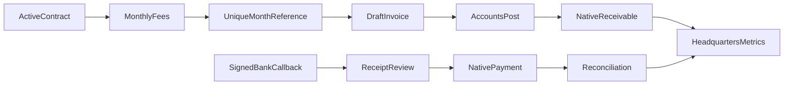

# Headquarters source scope

Independent fictional franchise contracts, regions, billing contacts, fee definitions,
monthly draft native invoices, concurrency-locked duplicate billing protection,
native receipts/reconciliation and signed generic bank callbacks are authored.
The installer can seed 80 fictional campuses; 250 is a proposed demo fee, not a
historical business term. HQ metrics are computed from actual posted accounting
documents, including signed credit notes. Draft invoices do not appear as billed
or collected revenue. Current residuals are reported, not reconstructed historical
cash balances; collection means billed-document amount less current residual.

Configure a chart and sales/bank journals, review the 80 records, bill a month,
post selected invoices, register full/partial native payments and view the HQ
dashboard or QWeb report. A generic bank adapter uses the exact signed callback
contract described in scripts/simulate_bank.py and creates reviewable receipts.
Payment application is explicit, native and idempotent. Advances and named bank
APIs are not invented. Native invoice filters/grouping provide account statements
and regional receivable drilldowns; a separate historical statement engine is
not included. No business terms or client records were copied. Runtime validation for this source snapshot was deferred by request.

